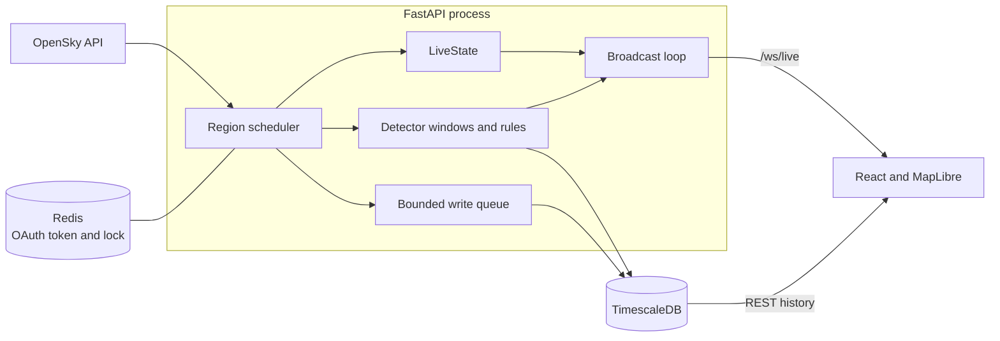

# SkyWatch

A real-time airspace explorer with rule-based anomaly detection. SkyWatch polls live aircraft positions from OpenSky, streams them to a MapLibre map over WebSockets, stores history in TimescaleDB, and flags physically implausible tracks as they happen.

Built with FastAPI, asyncio, React, TypeScript, TimescaleDB and Redis. Status: **v0.4.0, local only, rules only.**

## Features

- **Live map:** viewport-filtered snapshots and deltas over WebSockets, smooth motion between reports, stale-data indicators, and automatic reconnect with backoff.
- **Aircraft details:** current state, recent track history and recent anomalies for a selected aircraft.
- **Anomaly detection:** rules for impossible speed, climb and turn rates, teleports and speed mismatches, delivered live and persisted as merged alerts.
- **Adaptive ingestion:** per-region polling that responds to traffic density, rate limits and the remaining daily credit budget.
- **Failure isolation:** database backpressure can lose history but never blocks the live feed. Slow WebSocket clients drop frames and receive a fresh snapshot.
- **Measured evaluation:** a frozen, reproducible dataset with injected anomalies and an explicit list of blind spots.

## Architecture



Polling, live state, detection and broadcasting share one API process, so live aircraft exist only in that process's memory. Each observation reaches live state and the detector before it is offered to the history queue.

## Run locally

You need Docker, Node 22 and [OpenSky API credentials](https://opensky-network.org/).

```bash
cp .env.example .env
```

Set `OPENSKY_CLIENT_ID` and `OPENSKY_CLIENT_SECRET` in `.env`, then start the backend and frontend:

```bash
docker compose up -d
```

```bash
cd frontend && npm ci && npm run dev
```

Open <http://localhost:5173>. API docs are at <http://localhost:8000/docs>.

Polling spends OpenSky credits, so stop the API when you finish. The volumes keep your history.

```bash
docker compose stop api
```

## API

| Endpoint | Purpose |
|---|---|
| `GET /health` | Dependency status and ingestion, WebSocket and detector counters |
| `GET /aircraft?bbox=south,west,north,east` | Live aircraft in a viewport |
| `GET /aircraft/{icao24}` | Current state of one aircraft |
| `GET /aircraft/{icao24}/track` | Stored track history, up to 24 hours |
| `GET /anomalies` | Open and persisted alerts, filterable by time, type and aircraft |
| `WS /ws/live` | Send a viewport message; receive `snapshot`, `delta` and `anomaly` frames |

## Configuration

| Variable | Default | Purpose |
|---|---|---|
| `OPENSKY_CLIENT_ID`, `OPENSKY_CLIENT_SECRET` | empty | OpenSky OAuth credentials |
| `DATABASE_URL`, `REDIS_URL` | Compose services | Storage connections |
| `DAILY_CREDIT_BUDGET` | `4000` | Local limit on OpenSky credits per day |
| `POLL_REGIONS` | `bay_area,socal` | Regions to poll |
| `WS_ALLOWED_ORIGINS` | local dev origins | Exact browser origins allowed on `/ws/live` |

Test-only settings are described in [the testing guide](docs/testing-readiness.md).

## Testing

Backend tests use a real TimescaleDB with transaction rollback. CI runs Ruff, pytest, mypy, and the frontend build and lint.

```bash
docker compose exec -T api ruff check .
docker compose exec -T api pytest
docker compose exec -T api mypy --cache-dir=/tmp/skywatch-mypy-cache app
```

```bash
cd frontend && npm run build && npm run lint
```

## Results

These come from local measurements and a controlled evaluation.

| Measure | Result |
|---|---|
| Evaluation set | 615 held-out track sessions, 30 injected events, 50,515 candidate windows |
| Window precision / recall / F1 | 69.12% / 62.94% / 65.89% |
| Event recall | 22 of 30 (73.33%) |
| Merged-alert precision | 58.18% |
| Replay of 113,650 real observations | 54 alerts reviewed; one turn-rule guard reduced this to 42 |
| Detector tick p95 (389 windows) | 10.70 ms |
| Broadcast tick p95 (389 windows) | 12.38 ms |

Staleness thresholds come from observed report intervals: aircraft fade at 20 seconds and are removed after 60 seconds. The detector's 36-second gap limit is the highest regional p99 in the [measured gap distribution](docs/gap_distribution.txt).

## Limitations

- These are injection results on recorded traffic assumed to be normal. They are not detection rates against real spoofing, and the post-review baseline is not an independent holdout.
- The ×0.1 velocity injection was missed in all five events, and subtle position drift remains a blind spot.
- Latency figures are local smoke measurements at about 100 aircraft, not a load-test ceiling.
- A hard crash can lose open or pending alerts, and detector windows start empty after a restart.
- SkyWatch has no authentication and is not deployed publicly. WebSocket Origin checks are not authentication.

## Documentation

- [Architecture and learning guide](docs/skywatch_architecture.md)
- [Testing and TestForge integration](docs/testing-readiness.md)
- [Rules baseline and evaluation](docs/rules_baseline.md)
- [Anomaly taxonomy](docs/taxonomy.md)
- [Implementation decisions](docs/phase4_implementation.md)
- [Remaining work](docs/phase5_checklist.md)
- [Phase 3](docs/evidence/phase3/PHASE3_COMPLETION.md) and [Phase 4](docs/evidence/phase4/phase4_completion.md) verification records
