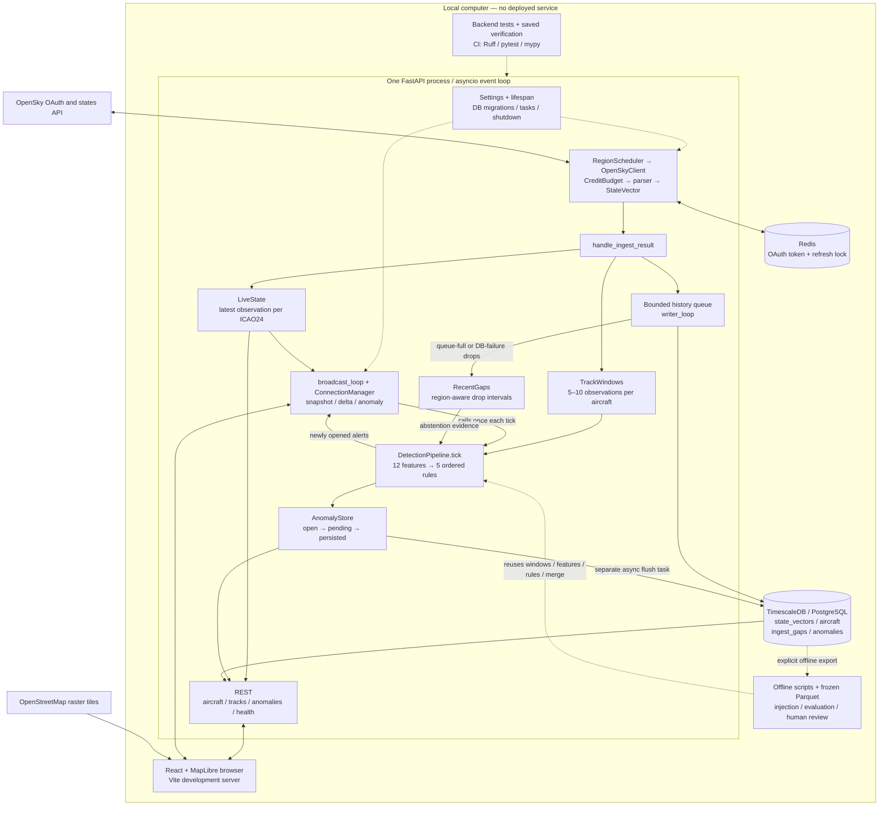
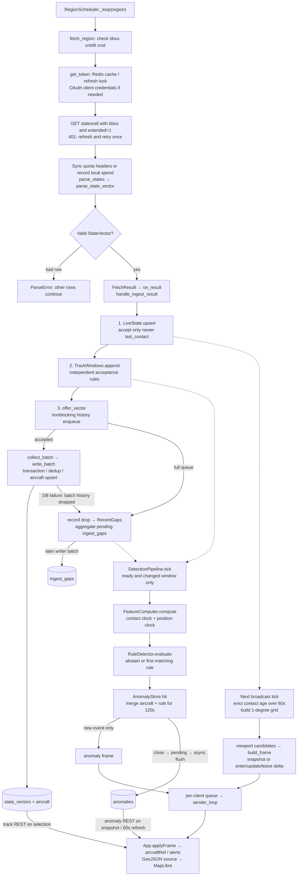
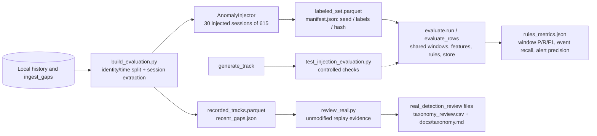

# SkyWatch: architecture and learning guide after Phase 4

This document describes behavior implemented as of Phase 4 (September 30, 2026), not a proposed design. File links are relative to this document.

## 1. Interview architecture diagram

Read from OpenSky into the three branches: current state, detection, and durable history. Everything inside the local boundary runs on your computer. OpenSky and OpenStreetMap are external dependencies, so local-only does not mean offline.

**Scope:** Track A rules and Track C real-data review exist. Track B / Isolation Forest was intentionally skipped. There is no model training or model-serving path; health returns `model_version: null`. The frontend is a separate local Vite process, not a Compose service. Redis is not the live aircraft store or a message bus.

Evidence: [main.py](../backend/app/main.py), [docker-compose.yml](../docker-compose.yml), [App.tsx](../frontend/src/App.tsx), [Phase 4 decisions](phase4_implementation.md).

## 2. One OpenSky state vector, end to end

The three ingest calls are sequential, but accepting a vector into one branch does not gate the others. Even a duplicate rejected by LiveState is still offered to TrackWindows and history. A positionless vector can remain in LiveState and history, but cannot enter a detector window or appear on the map.

**Follow the clocks.** `last_contact` orders live state and windows, becomes the database `time`, and controls freshness/eviction. `time_position` is used for movement derivatives and browser extrapolation. The response's top-level `time` becomes `QueuedVector.fetched_at`, used as drop provenance; it is not the stored observation time. Database `ingested_at` defaults to database `now()`. Local tick time drives alert opening timestamps and expiry checks.

### Startup, polling, and shutdown

1. [config.py](../backend/app/config.py) loads Pydantic settings from environment and the root-relative `.env` path. Defaults enable Bay Area and SoCal, at initial 15s and 20s intervals. Other regions are commented out. Secrets are not part of this guide.
2. [lifespan](../backend/app/main.py) connects the database, applies checksum-verified migrations, then connects/pings Redis. It creates LiveState, TrackWindows, and DetectionPipeline, clears recent in-memory gaps, and starts anomaly flushing, broadcasting, history writing, and region scheduling.
3. [RegionScheduler](../backend/app/ingest/scheduler.py) runs one asynchronous loop per configured region. `next_interval` smooths density/budget adjustments within 5–300s. Budget pressure begins below 20%. Failed fetches use a 30s backoff; a supplied retry delay takes precedence, with a 5s floor.
4. [OpenSkyClient](../backend/app/ingest/opensky.py) checks bbox affordability, gets a cached OAuth token, and fetches a region. A Redis `SET NX EX` lock coordinates token refresh; release checks lock ownership. A 401 triggers one refresh/retry. Server remaining-credit headers override the local estimate; otherwise successful fetches spend estimated credits. [CreditBudget](../backend/app/ingest/budget.py) is process-local and resets on UTC date change, not a Redis quota ledger.
5. Shutdown cancels broadcasting, stops region polling, waits up to 10s for accepted history queue work, cancels the writer, stops anomaly flushing, closes all open alerts and attempts persistence, then disconnects Redis and the database. This is a best-effort drain, not a durability guarantee.

### Detection contract

[TrackWindows](../backend/app/detect/windows.py) keeps at most 10 samples per ICAO24, requires 5 for readiness, trims spans beyond 180s, and clears the previous window when a contact gap exceeds 36s. It rejects missing positions, nonfinite contact/coordinates, and non-increasing contact timestamps. Broadcast uses the same 60s eviction cutoff for live state and detector windows; restart does not backfill either from the database.

[FeatureComputer](../backend/app/detect/features.py) computes these 12 values, with metadata kept separately:

| Group | Feature names | Meaning |
|---|---|---|
| Speed | `implied_speed_ms`, `reported_speed_ms`, `speed_mismatch_ratio` | Median position-derived speed, median reported speed, median valid pair ratio |
| Turns | `turn_rate_deg_s`, `turn_accel_deg_s2` | Signed peak absolute heading rate and acceleration; shortest-angle wrap |
| Vertical | `reported_vertical_rate_ms`, `implied_vertical_rate_ms`, `vertical_mismatch_ms` | Peak absolute signed rates and peak absolute discrepancy |
| Jumps | `jump_distance_m`, `jump_speed_ms` | Maximum valid pair displacement and speed |
| Sampling | `update_interval_s`, `interval_variance_s2` | Median and population variance of contact intervals |

Contact intervals must be within [1,36] seconds. A usable motion pair also needs advancing position times within [1,36], finite coordinates, velocity, and both headings. Missing optional vertical values stay missing. Ratios require reported speed at least 25m/s. No usable pairs means no features. Position/heading/altitude derivatives use position time, an explicit limitation when telemetry fields update asynchronously.

[RuleDetector.evaluate](../backend/app/detect/rules.py) abstains for uncomputable, any-on-ground, or region-matched ingest-gap windows. It then returns only the first match:

| Priority | Rule | Actual condition |
|---|---|---|
| 1 | `rule:impossible_speed` | Median implied speed >617m/s |
| 2 | `rule:teleport` | Peak jump speed >617m/s and median contact interval <60s |
| 3 | `rule:impossible_climb` | Absolute implied vertical rate >40.6m/s |
| 4 | `rule:impossible_turn` | Median reported speed ≥25m/s and absolute turn rate >15°/s |
| 5 | `rule:speed_mismatch` | Available ratio >3 or <0.33 |

[DetectionPipeline.tick](../backend/app/detect/pipeline.py) runs synchronously inside the broadcast loop before frames are built, even with zero browser connections. `scored_at` avoids rescoring an unchanged window. The loop sleeps 1s after each pass, so it is approximately one tick per second, not a strict fixed-rate scheduler.

[AnomalyStore](../backend/app/detect/store.py) merges hits by `(icao24, detector)`, extends the event end, increments hits, and retains peak severity evidence. Severity is threshold exceedance, not an ML probability. A hit separated by more than 120s starts a new event; expiry also closes events whose last hit's window end is more than 120s behind tick time. Only newly opened events emit frames. Closed events enter `pending`; a separate async task attempts insert-only persistence every second, with unique `event_id` and `ON CONFLICT DO NOTHING`.

### Storage, gaps, and recovery

[writer.py](../backend/app/ingest/writer.py) has a 10,000-item history queue; collection stops at 1,000 vectors or 0.5s after its first item. A full queue drops the newest history offer. Database failures drop that batch's history, record the loss, and retry later batches; failed history is not replayed. Both loss paths update in-memory RecentGaps immediately and aggregate persistent gap records by region/reason. Pending gaps are flushed with a later collected batch. Polling failures themselves do not create these writer gap records; long observation gaps reset TrackWindows.

[Migrations](../backend/migrations/001_init.sql) create a one-day-chunk `state_vectors` hypertable, `(icao24,time)` unique index, PostGIS generated position/GiST index, and aircraft metadata table. [002](../backend/migrations/002_compression.sql) enables compression after two days, segmented by aircraft, and 30-day state-vector retention. [003](../backend/migrations/003_ingest_gaps.sql) adds ingest gaps; [004](../backend/migrations/004_anomalies.sql) adds ordinary PostgreSQL anomaly rows. The inspected REST queries do not use PostGIS for live viewport filtering. The state-vector retention policy does not cover every table.

Runtime database failure can leave live ingestion/display/scoring operating, but startup requires successful DB/migration/Redis setup. Redis failure prevents token access and thus successful polling. Open alerts, pending anomaly retries, LiveState, and windows are memory-only: a hard crash loses them. Pending anomaly memory is uncapped during a long database outage. An open alert may extend for much longer than 120s before persistence.

### REST and WebSocket contracts

| Endpoint | Owner/data source | Bounds and behavior |
|---|---|---|
| `GET /health` | `main.health`; dependencies and in-process counters | DB/Redis checks, credits, queue losses, WS/tick metrics, detector counts/timing; `model_version=null` |
| `GET /aircraft?bbox=s,w,n,e` | `api.aircraft.get_aircraft`; LiveState | Maximum bbox area 400 square degrees, no antimeridian; missing positions omitted |
| `GET /aircraft/{icao24}` | `get_aircraft_by_icao24`; LiveState | Lowercases identity; absent live record returns 404 |
| `GET /aircraft/{icao24}/track` | `api.tracks.get_aircraft_track`; TimescaleDB | Default 1h/5,000 rows; clamp to 24h; maximum 20,000; newest first; limit+1 detects truncation |
| `GET /anomalies` | `api.anomalies.get_anomalies`; DB + open/pending memory | Default 1h/500; max 24h/5,000; filters type, ICAO24, synthetic flag; defaults exclude synthetic |
| `WS /ws/live` | `api.ws.live_websocket`; ConnectionManager | Exact allowed origins (origin-less clients accepted); maximum 200 connections |

Anomaly REST takes its memory snapshot before awaiting SQL, then unions/deduplicates by event ID. It filters by **window_start**, not interval overlap; a long-running event starting before the requested range can be absent. Database errors still fail this endpoint even if memory contains alerts.

The browser sends `{t:"viewport", bbox:[south,west,north,east]}` on connect and map `moveend`. The server resets that client's known state and sends a snapshot, then deltas containing `enter`, `update`, and `leave`. A one-degree grid narrows aircraft candidates. Row order is `icao24, lat, lon, baro_alt, track, velocity, vrate, on_ground, time_position, last_contact, callsign`.

Each connection has a four-frame outbound queue. Overflow drops that offered frame, clears known state, and marks the next aircraft frame as a snapshot. Already queued frames are not flushed. A separate sender awaits network I/O. Newly opened anomaly frames share the queue and sequence counter; they are sent to every connection with a viewport, without geographic filtering. `App.tsx` accepts frame types but does not validate sequence continuity or dynamically decode the `fields` array. Snapshot-triggered REST refetch and periodic refresh recover anomaly history; this is not a durable event stream.

### Browser rendering

[App.tsx](../frontend/src/App.tsx) owns the map, connection, alert cache, selected aircraft, and rendering helpers in one component; there are no separate implemented frontend service/store modules to draw.

`applyFrame` converts rows with `rowToFeature` into an authoritative `aircraftRef` map. Snapshots replace it; deltas mutate it. `updateMapSource` serializes worker updates: snapshots use `setData`, later changes use `updateData` with feature IDs. React state holds summaries and selected-aircraft details, not the full changing collection.

A 100ms visual timer extrapolates from velocity/heading/position time, capped at 30s. Contacts aged 20s become stale and freeze at the last rendered position with reduced opacity. Small corrections blend over 500ms; corrections ≥2km snap. These predicted positions never feed detection or storage. Server eviction removes contacts older than 60s on subsequent ticks.

Clicking an aircraft uses the local feature for details and fetches its REST track; `trackFeatures` reverses newest-first points into chronological GeoJSON. An AbortController and selected-ID check prevent stale responses replacing a newer selection. Anomalies populate pink rings and labels, refresh on every snapshot and every 60s, and age out using their latest known window end after an hour. Socket failure clears the live collection and reconnects with jittered exponential backoff capped at 30s.

[Vite](../frontend/vite.config.ts) proxies `/aircraft` and `/anomalies` to localhost:8000. WebSocket URL is explicitly `ws://localhost:8000/ws/live`. Tiles come directly from OpenStreetMap. The installed `pmtiles` dependency is not used in the inspected App.

## 3. Module ownership map

Paths below name actual files and implemented symbols. All backend paths are under `backend/`.

| File | Key symbols | Owns |
|---|---|---|
| [app/config.py](../backend/app/config.py) | `Settings`, `Region`, `REGIONS`, `settings` | Environment settings and enabled region definitions |
| [app/main.py](../backend/app/main.py) | `lifespan`, `handle_ingest_result`, `get_budget_fraction`, `health`, `app` | Composition, task lifecycle, ordered ingest fan-out, router registration |
| [app/models.py](../backend/app/models.py) | `StateVector`, `StatesSnapshot` | Immutable domain data, nulls, coordinates, identity normalization |
| [app/ingest/opensky.py](../backend/app/ingest/opensky.py) | `OpenSkyClient`, `FetchResult`, `states_budget` | HTTP/OAuth, token caching and lock, quota metadata, parse orchestration |
| [app/ingest/budget.py](../backend/app/ingest/budget.py) | `CreditBudget`, `bbox_cost` | UTC daily local quota and bbox cost tiers |
| [app/ingest/scheduler.py](../backend/app/ingest/scheduler.py) | `RegionScheduler`, `next_interval` | Region tasks, adaptive polling, backoff |
| [app/ingest/parser.py](../backend/app/ingest/parser.py) | `parse_states`, `parse_state_vector`, `ParseResult`, `ParseError` | 17/18-field arrays to models; per-row failures |
| [app/state.py](../backend/app/state.py) | `LiveState`, `LiveRecord` | Latest-by-contact aircraft map and eviction |
| [app/detect/windows.py](../backend/app/detect/windows.py) | `Sample`, `TrackWindows` | Ordered bounded detector inputs shared with replay |
| [app/detect/features.py](../backend/app/detect/features.py) | `FeatureComputer`, `TrackFeatures`, `haversine`, `ang_delta`, `FEATURE_COLUMNS` | Feature computation, guards, skip accounting |
| [app/detect/rules.py](../backend/app/detect/rules.py) | `RuleDetector.evaluate` | Ordered first-match rules and abstentions |
| [app/detect/pipeline.py](../backend/app/detect/pipeline.py) | `DetectionPipeline.tick`, `persist`, `flush_loop`, `health` | Changed-window scoring and independent persistence |
| [app/detect/gaps.py](../backend/app/detect/gaps.py) | `RecentGaps`, `recent_gaps` | Region interval merge/overlap; 600s retention at tick |
| [app/detect/store.py](../backend/app/detect/store.py) | `OpenAnomaly`, `AnomalyStore`, `severity` | Event merge, peak evidence, close, pending retries, idempotent inserts |
| [app/ingest/writer.py](../backend/app/ingest/writer.py) | `QueuedVector`, `offer_vector`, `collect_batch`, `write_batch`, `writer_loop` | History queue, dedup, transactional writes, drop provenance |
| [app/db.py](../backend/app/db.py) | `init_pool`, `pool`, `close_pool`, `check_db` | Per-process asyncpg pool; connect/disconnect aliases |
| [app/redis_client.py](../backend/app/redis_client.py) | `connect_redis`, `get_redis`, `check_redis`, `disconnect_redis` | Shared Redis client lifecycle |
| [app/migrate.py](../backend/app/migrate.py) | `apply_migrations`, `calculate_checksum` | Ordered migrations and checksum history |
| [app/api/aircraft.py](../backend/app/api/aircraft.py) | `BBox`, `parse_bbox`, `get_aircraft`, `get_aircraft_by_icao24` | Live REST queries |
| [app/api/tracks.py](../backend/app/api/tracks.py) | `get_aircraft_track` | Bounded history SQL and response |
| [app/api/anomalies.py](../backend/app/api/anomalies.py) | `get_anomalies` | Filtered durable/in-memory event union |
| [app/api/ws.py](../backend/app/api/ws.py) | `ConnectionManager`, `Connection`, `Viewport`, `build_grid`, `candidates`, `build_frame`, `offer_frame`, `broadcast_loop`, `sender_loop`, `receiver_loop` | Per-client state, protocol, backpressure, scoring tick integration |
| [frontend/src/main.tsx](../frontend/src/main.tsx) | React root | Browser entry point |
| [frontend/src/App.tsx](../frontend/src/App.tsx) | `App`, `rowToFeature`, `trackFeatures`; nested `applyFrame`, `updateMapSource`, `connectWebSocket`, `renderFeature` | Map, WebSocket, UI, extrapolation, history and alerts |
| [app/detect/synthetic.py](../backend/app/detect/synthetic.py) | `generate_track`, `destination` | Seeded coherent test tracks; optional sampling/null parameters |
| [app/detect/inject.py](../backend/app/detect/inject.py) | `AnomalyInjector`, `InjectionLabel` | Labeled corruptions that preserve original clocks |
| [app/detect/evaluate.py](../backend/app/detect/evaluate.py) | `evaluate_rows`, `run` | Offline window/event/merged-alert metrics, exclusions |
| [scripts/build_evaluation.py](../backend/scripts/build_evaluation.py) | `heldout`, `main` | Query local history, identity/time split, session extraction, frozen injection dataset |
| [scripts/review_real.py](../backend/scripts/review_real.py) | Module-level replay | Unmodified history replay and evidence export for human review |

## 4. Tests and evaluation are a separate evidence path

The frozen benchmark uses real-source sessions with injected copies, not purely generated clean flights. `synthetic.generate_track` supplies controlled tests; it is not a trained model or the source of the frozen real-history corpus. Evaluation does not insert synthetic data into the live database.

| Tests/artifacts | What they establish |
|---|---|
| `test_parser.py`, `test_opensky.py`, `test_token_lock.py`, `test_budget.py` | Row/null behavior, mocked HTTP success/failures, refresh concurrency, credit accounting |
| `test_scheduler.py`, `test_region_scheduler.py`, `test_lifespan.py` | Pure policy, async scheduling/backoff/callbacks, lifecycle |
| `test_ingest_bridge.py`, `test_live_state.py`, `test_writer.py`, `test_dependency_recovery.py` | Live/window independence from queue drops, ordering, storage behavior and recovery |
| `test_aircraft_api.py`, `test_ws.py`, `test_realtime_metrics.py`, `test_phase3_completion.py` | API bounds, viewport/delta logic, overflow/snapshot recovery, timing metrics and origins |
| `tests/detect/test_windows.py`, `test_features_rules.py`, `test_pipeline.py` | Readiness, two clocks, nulls, rule order/abstention, merge/persistence and REST union |
| `tests/detect/test_injection_evaluation.py` | Seeded generation, injection labels/clocks, exclusions, merge scoring and blind spots |
| `tests/conftest.py` | Real DB fixture applies migrations, then rolls back test data in an outer transaction |
| `.github/workflows/ci.yml` | Backend Ruff, pytest, mypy with TimescaleDB/Redis services; no frontend job here |
| `docs/evidence/phase4/phase4_pytest.txt`, `docs/evidence/phase4/phase4_mypy.txt`, `docs/evidence/phase4/phase4_ruff.txt`, `docs/evidence/phase4/phase4_frontend_build.txt`, `docs/evidence/phase4/phase4_frontend_lint.txt` | Saved Phase 4 verification; report records 131 tests passing, not a fresh run by this documentation task |
| `eval/manifest.json`, `labeled_set.parquet`, `recent_gaps.json` | Reproducibility inputs and provenance |
| `eval/rules_metrics_before.json`, `rules_metrics.json` | Before/after the low-speed turn guard |
| `docs/gap_distribution.txt`, `eval/sampling_profile.json` | Observed gap calibration and sampling/null profile; not automatic online tuning |
| `docs/rules_baseline.md`, `taxonomy.md`, `docs/evidence/phase4/phase4_health.json` | Metric definitions/limitations, provisional real-alert review, captured runtime health |

Saved final evaluation: **69.12% window precision, 62.94% recall, 65.89% F1; 22/30 events caught (73.33%); 58.18% merged-alert precision**. About 13.77% of candidate windows are excluded. Controls are assumed negative; this does not measure verified spoofing detection. Post-review scores reuse the frozen cohort, not a new independent holdout. Velocity ×0.1 injections were missed below the speed-ratio floor; subtle drift was weak. Offline replay scores each accepted observation, whereas live detection scores changed windows on broadcast ticks.

Saved health/report timings are approximately **10.7ms detector p95 and 12.4ms whole-tick p95**, including idle ticks. They are local smoke measurements, not end-to-end source-to-browser latency or capacity benchmarks. See [completion report](phase4_completion.md) and [baseline](rules_baseline.md).

## 5. A 2–3 minute interview explanation

“SkyWatch is a local full-stack aircraft monitoring project. It takes OpenSky telemetry for the Bay Area and Southern California, displays live aircraft on a React and MapLibre map, and flags physically implausible telemetry with explainable rules.

Starting on the left of the diagram, a FastAPI lifespan initializes TimescaleDB, applies migrations, connects Redis, and starts asynchronous background tasks. One polling loop runs per region. The OpenSky client handles OAuth, caches the token in Redis, coordinates token refresh with a lock, and tracks the request-credit budget. Polling adapts to aircraft density and remaining credits. The parser validates each state vector independently so one malformed row does not discard the snapshot.

The key design choice is the three-way split after parsing. Each observation updates the in-memory live state and detector window before it is offered to a bounded database queue. That lets the live path continue when history storage falls behind. The writer batches and deduplicates observations into TimescaleDB and records history losses as region-specific gaps.

Phase 4 adds windows of five to ten observations per aircraft. I distinguish contact time from position time, compute twelve motion and sampling features, and evaluate five ordered physics rules. Windows with insufficient data, ground observations, or recorded ingestion gaps abstain. Detection runs once per broadcast tick for changed windows. Repeated hits merge into events, and a separate task persists closed events without waiting inside the scoring path. I intentionally skipped Isolation Forest to focus on an explainable, measurable baseline.

On the right, the server sends viewport-filtered snapshots and deltas over WebSockets. Slow clients have bounded queues and recover through snapshots. The browser keeps aircraft outside React component state, updates MapLibre GeoJSON, and uses short visual extrapolation between observations. Selecting an aircraft fetches its recorded track. Separate anomaly frames and REST history populate the alert rings.

For evaluation, I replayed a frozen set of 615 real-source sessions with 30 injected events. The saved results show about 65.9% window F1 and 73.3% event recall. I documented exclusions and false-positive causes, including weak subtle-drift detection. These are controlled evaluation results, not proof of real-world spoofing detection. The main tradeoff is that live state and unpersisted alerts remain in memory, which is acceptable for this local project but limits crash durability.”

## 6. How to study this repo, step by step

Do one row at a time. Read the implementation, then its tests, then explain the checkpoint without looking at this guide.

| Order | Read | Exercise / checkpoint |
|---|---|---|
| 1 | `docker-compose.yml`, `config.py`, `main.lifespan`, `test_lifespan.py` | Draw the local processes and list the four background responsibilities. Explain which dependencies must work at startup. |
| 2 | `models.py`, `ingest/parser.py`, `test_parser.py` | Trace a 17-field row and an 18-field row. Explain why missing altitude stays null and why one bad row does not kill a snapshot. |
| 3 | `ingest/budget.py`, `opensky.py`, `scheduler.py` and their tests | Walk through cached token, expired token, 429, and exhausted credit cases. Separate polling policy from HTTP behavior. |
| 4 | `main.handle_ingest_result`, `state.py`, `test_ingest_bridge.py` | Follow one duplicate and one positionless vector into all three branches. Explain why a full history queue does not reject live state. |
| 5 | `detect/windows.py`, `features.py`, their tests | Manually trace contacts at 0,10,20,30,40s, then a gap to 80s. Readiness becomes true at sample five, then resets after the 40s gap. Compare contact and position clocks. |
| 6 | `detect/rules.py`, `gaps.py`, `test_features_rules.py` | List the five priorities; explain which rule wins if multiple thresholds fail and why ground/gap evidence causes abstention. |
| 7 | `detect/pipeline.py`, `store.py`, `test_pipeline.py` | Trace a new hit, a merged hit, expiry, failed flush, and retry. Distinguish an in-memory alert from a durable row. |
| 8 | `ingest/writer.py`, migrations, `test_writer.py`, `test_dependency_recovery.py` | Explain batch timing, dedup, queue-full loss, DB-failure loss, and how each gap is recorded. |
| 9 | `api/aircraft.py`, `tracks.py`, `anomalies.py` | For every endpoint, identify memory versus SQL, time bounds, limits, and failure behavior. Explain why anomaly history still needs the DB. |
| 10 | `api/ws.py`, `test_ws.py`, `test_realtime_metrics.py` | Construct a snapshot and then an enter/update/leave delta. Fill the four-frame queue and explain the next snapshot. Note that anomaly frames are not viewport-filtered. |
| 11 | `frontend/src/App.tsx` | Follow `connectWebSocket → applyFrame → updateMapSource → renderFeature`. Separate authoritative positions, visual predictions, and selected-track history. |
| 12 | `detect/inject.py`, `evaluate.py`, scripts, `docs/rules_baseline.md`, `eval/manifest.json` | Explain window precision versus event recall, what gets excluded, and why an injected anomaly benchmark is not verified attack attribution. Practice the interview script with the diagram. |

For focused test practice, run only the relevant existing test file with the repo's configured environment. Database tests need TimescaleDB and correct connection settings. Avoid rerunning `build_evaluation.py` merely to learn: it queries current history and overwrites the frozen artifacts. If reproducing metrics, pass a new temporary output filename to `app.detect.evaluate` so the saved baseline remains intact.
